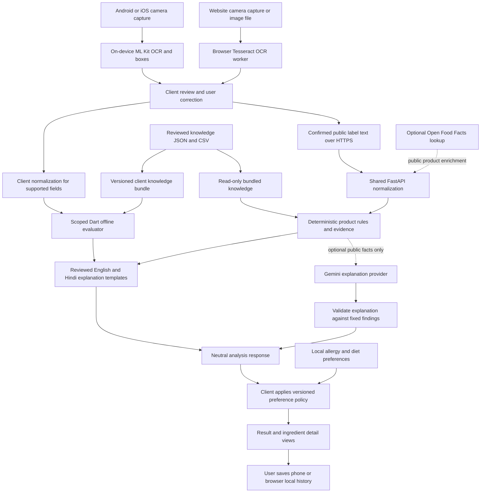

# Unlabel data flow and ownership

Status: planned feature architecture. The minimal Flutter starter and manual build/release workflow are foundation work; scanning, OCR, online/offline rule evaluators, local databases, and AI connections below are not implemented.

One Flutter app lives directly in `frontend/` and targets Android, iOS, and the responsive website. `frontend/web/` is its web platform directory. Platform OCR feeds a shared scan model; a Dart evaluator can handle a supported offline subset and FastAPI can handle expanded online rules. Both consume the same canonical declarative knowledge. Later website/API are separate Vercel projects. Local preferences map neutral facts to individual reasons. Gemini optionally rephrases findings.

## End-to-end scan

1. Shared `frontend/lib/features/scanner/` guides front and back capture within one session. The user verifies that both sides belong to the same product; matching a barcode or name is supporting evidence, not a substitute for that confirmation.
2. Platform adapters under `frontend/lib/core/camera/` supply images, dimensions, orientation, and timestamps. Images remain client-local by default. The website offers an image-file alternative to camera access.
3. `frontend/lib/core/ocr/` will expose native ML Kit and browser Tesseract.js worker adapters through one interface. Browser JavaScript interop and required box output are future tasks. Both return the same draft shape; mobile-only plugin imports cannot reach the web implementation. Native live boxes are provisional; web OCR is capture-first, with live processing considered only after measurements.
4. `frontend/lib/features/scanner/data/` assembles a scan draft: original text, corrected text, capture side, boxes, and completeness flags. The review screen asks the user to correct critical nutrition values and ingredient text.
5. `frontend/lib/core/analysis/` evaluates supported corrected fields using `core/knowledge/` and the bundled declarative rules. Unknown inputs or unsupported rules return `insufficient_information`; offline results identify coverage and knowledge version. Optional online analysis uses `core/network/` to send confirmed public text, category, language, and quality flags. It excludes photos, preferences, history, identifiers, and unrelated contact text. Planned contracts live in `contracts/schemas/` and `contracts/examples/`.
6. `backend/app/services/parsing/` extracts nutrition, ingredients, claims, declarations, serving basis, and package identity. It preserves original tokens and corrections so every normalized fact is traceable.
7. `backend/app/services/analysis/` applies reviewed category-aware rules, including expanded rules outside the Dart subset. `backend/app/services/knowledge/` resolves aliases and evidence. Both evaluators use canonical IDs/knowledge versions; they do not maintain separately authored thresholds. Ambiguous or unsupported cases remain unknown.
8. `backend/app/services/personalization/` is reserved for a neutral product-fact and suitability-reason catalog/policy payload. It does not receive or store user profiles. The response identifies declared allergens, cross-contact statements, dietary declarations, nutritional findings, and evidence limitations.
9. `backend/app/providers/ai/` may rephrase selected public facts and fixed findings using `backend/app/prompts/`. Its input excludes preferences, raw images, scan history, and personal identifiers. `backend/app/schemas/` validates output; conflicting, missing, or unsupported statements trigger template fallback.
10. Shared `features/preferences/` maps neutral online/offline product facts to local preference IDs using the matching policy bundle. Preference mapping remains separate from nutrition/claim evaluation. `features/analysis/` displays individual reasons, evidence, mode, and supported-rule coverage together.
11. Each client's `features/history/` saves an explicit user-selected record through `core/storage/`. Store corrected inputs, neutral response, evidence/rule versions, date, and mode. Re-evaluating saved product facts against current local preferences does not change the original analysis. Phone and browser stores are separate; no automatic synchronization is planned.

## Where the knowledge originates

Knowledge is maintained before runtime. FSSAI food-label/claim regulations, relevant Legal Metrology material, authoritative ingredient references, and official provider documentation are selected and reviewed by teammates. A regulator document is not assumed to provide an OCR or product-data API.

| Location | Planned responsibility |
| --- | --- |
| `knowledge/sources/registry/` | Source URLs, issuing bodies, document titles, effective/retrieval dates, licensing notes, and review status |
| `knowledge/sources/downloads/` | Local reference downloads where storage and redistribution are permitted; not live runtime queries |
| `knowledge/rules/claims/` | Reviewed claim criteria, category/basis applicability, required inputs, and source references |
| `knowledge/rules/nutrition/` | Reviewed nutrient normalization/classification policies and applicability |
| `knowledge/rules/allergens/` | Canonical allergen IDs, ingredient aliases, cross-contact handling, and conservative evidence states |
| `knowledge/ingredients/` | Ingredient/additive identities, purposes, aliases, and bounded evidence summaries |
| `knowledge/translations/en/`, `knowledge/translations/hi/` | Reviewed language templates and glossary entries |
| `frontend/assets/knowledge/` | Later generated rules/glossary/EN-HI templates/preference-policy bundle shared by Flutter targets, with canonical IDs and versions |
| `backend/storage/runtime/` | Optional local-only derived SQLite index; ignored and rebuildable; hosted API must not depend on it |

Versioned JSON/CSV reviewed in Git is canonical. Later validation emits read-only backend and client bundles, including an explicit offline supported-rule list. SQLite is an optional local derived index, not a writable Vercel database. Hosted requests use immutable knowledge and request memory; no persistent shared filesystem/cache or global in-memory quota is assumed. Downloads never become trusted rules automatically. No vector database, embeddings, live scraping, or full RAG pipeline is required for the MVP.

Optional `backend/app/providers/products/` lookup can enrich a known public barcode using Open Food Facts. Each returned field keeps provider provenance and freshness. The captured package is the primary evidence; conflicting or incomplete external records cannot silently replace it. Basic scanning and analysis must work without this lookup.

## Normalization and evidence boundary

- Preserve per-serving, per-100 g, and per-100 mL bases separately. Compare only compatible bases; require serving quantity for conversion.
- Preserve units and distinguish sodium from salt, total sugar from added sugar, and kcal from kJ. Do not convert mass to volume without an evidenced density.
- Missing is not zero. Decimal separators, OCR substitutions, table-column ambiguity, and implausible values require correction or an unknown state.
- Ingredient order alone does not reveal exact nutrient amounts. Ingredient text cannot establish a numeric "high sodium" or "high sugar" classification.
- Every finding references its input fields, rule ID/version, category, evidence source, and applicable date. A current regulation may not apply to every historical package.
- A correction creates a new scan revision and invalidates findings derived from the changed input. Historical findings retain their original versions until the user requests reanalysis.
- Offline common nutrition/claim/allergen checks are scoped to reviewed bundled rules and evidence. An omitted rule, unsupported operator/category, or missing fact yields `insufficient_information`; no full offline regulatory coverage is promised.
- Gemini output is optional wording. It cannot invent evidence, override rule states, classify unknown allergies as safe, or provide treatment advice.

## Storage and lifecycle

| Data | Origin and processing | Final location and retention |
| --- | --- | --- |
| Package photos/live frames | Phone/browser camera or selected file; local OCR | Frames discarded after use; in-app photos temporary unless explicitly saved; original selected files remain user-owned |
| OCR draft and corrections | Client OCR and user | Client draft until completion/deletion; included in saved history only when requested |
| Analysis request | Confirmed public label text | Backend request memory; no default scan database or raw-content logs |
| Neutral findings and citations | Scoped Dart evaluator or shared backend rules | Retained in client draft/history with mode/coverage/version; backend discards request state after completion |
| Preferences/allergies | User on client | Phone/browser-local profile; editable/deletable; never sent to backend or Gemini |
| Saved analyses | Explicit client save action | Phone/browser-local history until deleted or storage is cleared/evicted; no cloud synchronization |
| Curated knowledge | Reviewed public references | Versioned canonical repository files; derived local bundles/indexes are rebuildable |
| Gemini request | Allowlisted public facts and evidence summaries | Optional external processing under the provider's current terms; no Unlabel server archive |
| Product enrichment | Optional public barcode lookup | Provider-tagged response facts; no persistent shared hosted cache is required |

Later mobile storage uses app-private storage and a small local database; web history uses browser-local IndexedDB behind an adapter. Final storage packages are later choices. Browser private mode, origin changes, eviction, and clearing site data can lose browser history; browsers are not a guaranteed backup. `data/private/` is ignored development data, not a production upload target. `data/fixtures/` holds owned/permitted, non-personal examples only.

## Failures and recovery

| Condition | Planned behavior |
| --- | --- |
| Backend reachable, no Gemini key/internet/quota | Complete deterministic analysis with reviewed English/Hindi templates; identify explanation mode |
| Gemini invalid or contradictory output | Discard generated wording and show templates for the same findings |
| Backend unavailable | Run bundled supported rules with local OCR/glossary/templates/history; show unsupported/missing checks as insufficient information, with offline coverage |
| OCR assets unavailable | Native bundled Latin model supports first-use offline OCR; web worker/core/language assets need initial load/cache and verified availability; never promise first-visit offline web OCR |
| Website camera unsupported/denied | Offer supported image selection and correction/manual entry; keep permissions actionable and stop camera tracks when leaving capture |
| Poor OCR or missing back label | Request correction/re-capture; run only rules with sufficient evidence and retain explicit unknown states |
| Optional product lookup fails | Continue with package evidence; disclose that enrichment was unavailable when relevant |
| Request interrupted | Preserve local draft for retry; do not save a successful result or mix responses from different revisions |
| Knowledge/policy versions incompatible | Retain original findings, skip incompatible mappings, and show unknown; never merge mismatched online/offline results silently |

Expanded online analysis requires the API Vercel project within its free limits; laptop/LAN remains a demo alternative. Website camera requires a secure context; hosted HTTPS must not depend on laptop HTTP. Web offline operation requires an initial successful load plus explicit service-worker/app/OCR/glossary/rule-asset caching; current Flutter web does not supply a default generated service worker. No first-visit offline promise. Origin allowlists, limits, abuse controls, platform networking, and server-only keys are future tasks.

## Validation planned for implementation

Owned parity fixtures must make Dart and Python agree for every supported shared rule, normalization basis, incomplete input, and evidence reference. Extra backend rules remain visibly outside offline coverage. Platform adapters share Dart models/policy; device checks measure native boxes, browser OCR speed/memory, and a genuinely offline cached web session. Starter/build checks do not prove any scanning or regulatory capability.
