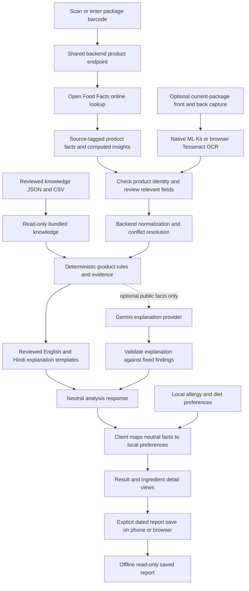

# Unlabel data flow and ownership

Updated **7 October 2026**. Backend **v0.6.0 Product Discovery** is independently
pushed, hosted-verified and published after the separate v0.5.0/v0.4.0 releases.
Nineteen routes preserve old contracts and add bounded dated identity search.
Frontend **0.1.0+2 Connected Label Reader** implements manual barcode/name lookup,
current/historical reports, corrected input and device-local libraries. Its
rendered/release gates are tracked separately; camera/OCR remains future scope.
Light is the first-use default; saved Light/Dark/System choice stays local.
Personal history/preferences/saved lists stay on-device. Only public package facts
use automatic anonymous-authenticated catalogue storage; no reviewer/admin app
accounts. Firebase retains free tier/no linked billing.
[Master plan](../planning/MASTER_PLAN.md) · [Backend review](../planning/BACKEND_V0_6_0_REVIEW.md)
· [Connected plan](../planning/CONNECTED_RELEASE_PLAN.md).

## Preserved lookup, normalization and claim paths

1. A caller supplies a supported barcode to the product route or separate nutrition route. The backend performs one fixed-origin OFF v3.6 read with an application User-Agent, an eight-second default total deadline and a 512 KiB default decoded-response budget. It validates identity and source data; no provider key or image download is needed.
2. Product lookup returns the unchanged product v1 contract. Nutrition lookup reads only eligible `nutrition.input_sets` from packaging/manufacturer sources, excluding estimated/computed/qualified values. The adapter processes at most 16 tables and 64 accepted rows, omitting an over-budget table as a whole. Original direct values, accepted table source, preparation and basis remain visible. Separate tables are not combined.
3. Independently, a caller can POST 1–64 user-confirmed structured nutrient rows with UUID request/session IDs, a correction revision and a completeness declaration. No OFF connection is required for this path. Normalization stores no scan and accepts no raw OCR/image/profile. The actual input body is bounded to 32 KiB before JSON parsing.
4. The pure normalizer converts kcal/kJ and mass units, and scales known mass or volume bases to the same unit per 100. An unknown serving remains per serving. Missing and explicit unknown values retain reasons; zero stays zero. Sodium/salt, total/added sugar and available/total carbohydrates stay separate without inference.
5. The response retains original rows, conversion descriptions and source-row references. Lookup origin is `open_food_facts_community_data`; confirmed input origin is `user_confirmed_label`. No merge occurs across these origins. `complete` indicates successful processing of submitted rows, not complete nutrient coverage or a health verdict; conflicting contexts/duplicates require correction. Comparable OFF tables that disagree remain visible with `provider_tables_disagree` and `needs_correction`.
6. Responses use `no-store` and contain no provider secrets. Validation errors are bounded/redacted and do not echo submitted values. Request content is not logged or retained by this backend. The current client correlates session/request/revision, records viewed reports locally and bookmarks only on explicit choice. Confirmed public facts use separate automatic intake; personal records are not uploaded in v0.1.0.
7. Separately, the backend build reads the committed India gzip, verifies compressed/decoded hashes and counts, and generates SQLite plus a receipt under `app/catalogue/data/`. Hosted startup validates the receipt, full database hash, manifest, integrity and counts. `GET /v1/catalogue` exposes source age and field limits; exact catalogue barcode reads make no OFF request and retain the existing export-origin contract. A missing receipt disables only catalogue access. Snapshot misses do not silently fall back to the live adapter.
8. The separate facts route returns the same exact identity/manifest plus optional direct nutrition, availability-aware canonical tags, provider schema/record-modification date and official selected-front image URL metadata. No image bytes or arbitrary URLs are served. Direct nutrition shares the live parser but retains export provenance; legacy aggregates remain unavailable. Older identity-only stores keep existing reads without enabling `catalogue_facts`.

## Implemented automatic observation and resolution path

1. The API accepts provisional/confirmed structured public observations. Client
   capture/OCR remains pending; current manual corrected entry is integrated with stable retry identity and independent analysis/storage outcomes.
2. Anonymous-token verification establishes private keyed ownership. No Share
   flag, photos/raw OCR, profiles or private history enter the request.
3. Server normalization and full/factual hashes preserve original rows/context.
   Exact retries retain receipts; semantic duplicates reuse active assertions.
4. Provisional/barcode-less observations remain private staging with seven-day
   expiry and bounded cleanup. Correct confirmed exact front/back/pairing facts
   can become qualified unreviewed candidates when compatible with known evidence.
   Conflicts and identity mismatches await exact-hash review/supersession.
5. Public resolution retains OFF/community source groups, typed selected fields,
   dates, completeness, alternatives and conflicts. Unknown cross-source nutrition
   revision is unselected; tables are not averaged or generically imputed.
6. Current-package confirmation is still required for claim checks. A historical
   candidate or moderator decision never supplies that confirmation automatically.
7. OFF-only resolution remains usable during community unavailability, including
   disabled storage. Neither source available returns 503; saving cannot replace
   or disable independent normalization/claim paths.

Firebase Unlabel is provisioned on free Standard database `unlabel` with no
billing. API push/hosted verification and publication passed separately. [Lifecycle](COMMUNITY_CATALOGUE.md).

## Planned end-to-end online lookup and label review

1. `frontend/lib/features/scanner/` offers barcode camera scanning or manual entry. `core/network/` calls `GET /v1/products/{barcode}`; `backend/app/providers/products/` performs the selected Open Food Facts lookup online.
2. The backend returns available identity, ingredient/nutrition/declaration facts and computed insights, tagged with provider, retrieval time, product revision where available, and completeness. Missing fields stay missing. Provider-computed scores/tags are separate from Unlabel's FSSAI checks.
3. The user checks identity and relevant fields against the package. A basic product report need not require front/back OCR if provider data is sufficient; it is explicitly based on the provider record, not proof that every current-package declaration was checked.
4. Optional capture supplies front claims, missing ingredient/nutrition panels, or conflict evidence. `core/camera/` keeps images local; `core/ocr/` later adapts native ML Kit and browser Tesseract.js through one interface. Web is capture/file-first; native live boxes are provisional. Mobile-only plugin imports cannot reach web code.
5. `features/scanner/data/` links barcode facts, original/corrected OCR, capture side, boxes, and completeness into one draft. The user confirms front/back belong to the same product. Current-package evidence takes precedence after review; confirming provider text does not erase its provider provenance.
6. `core/network/` submits the barcode/source snapshot and any confirmed public corrections/claims for online analysis. It excludes photos, preference profiles, history, identifiers, and unrelated contact text. The backend validates inputs and re-resolves provider facts when necessary; client-supplied classifications are not trusted rule results. Planned contracts live in `contracts/schemas/` and `contracts/examples/`.
7. Backend parsing/analysis normalizes units, resolves conflicts, and applies reviewed category-aware FSSAI criteria. `services/knowledge/` resolves aliases/evidence from canonical knowledge. Missing inputs, unsupported criteria, or unresolved contradictions yield `insufficient_information`. There is no required Dart legal/nutrition evaluator or Python/Dart rule-parity implementation in the MVP.
8. `backend/app/services/personalization/` is reserved for a neutral product-fact and suitability-reason catalog/policy payload. It does not receive or store user profiles. The response identifies declared allergens, cross-contact statements, dietary declarations, nutritional findings, and evidence limitations.
9. `backend/app/providers/ai/` may rephrase selected public facts and fixed findings using `backend/app/prompts/`. Its input excludes preferences, raw images, scan history, and personal identifiers. `backend/app/schemas/` validates output; conflicting, missing, or unsupported statements trigger template fallback.
10. Shared `features/preferences/` maps backend-issued neutral facts to local preference IDs while completing an online report. This small mapper does not reproduce FSSAI thresholds. Analysis presents provider insights, Unlabel checks, personal reasons, dates, and limitations separately.
11. `features/history/` explicitly saves the report through `core/storage/`, including selected source facts/corrections, findings, evidence/rule versions, dates, and the suitability snapshot/profile revision. Offline viewing preserves those dated findings rather than running fresh analysis. Phone/browser stores are separate; no automatic synchronization is planned.

## Where the knowledge originates

Open Food Facts supplies primary runtime product data and existing computed insights. Regulatory knowledge is maintained separately: FSSAI rules, relevant Legal Metrology material, ingredient references, and provider documentation are reviewed before encoding. A regulator document is not assumed to provide an OCR/product API; Open Food Facts computed classifications do not certify FSSAI compliance.

| Location | Planned responsibility |
| --- | --- |
| `knowledge/sources/registry/` | Source URLs, issuing bodies, document titles, effective/retrieval dates, licensing notes, and review status |
| `knowledge/sources/downloads/` | Local reference downloads where storage and redistribution are permitted; not live runtime queries |
| `knowledge/rules/claims/` | Reviewed claim criteria, category/basis applicability, required inputs, and source references |
| `knowledge/rules/nutrition/` | Reviewed nutrient normalization/classification policies and applicability |
| `knowledge/rules/allergens/` | Canonical allergen IDs, ingredient aliases, cross-contact handling, and conservative evidence states |
| `knowledge/ingredients/` | Ingredient/additive identities, purposes, aliases, and bounded evidence summaries |
| `knowledge/translations/en/`, `knowledge/translations/hi/` | Reviewed language templates and glossary entries |
| `frontend/assets/knowledge/` | Optional preinstalled glossary/EN-HI text and lightweight preference catalog; no required offline regulatory-rule bundle |
| `backend/storage/runtime/` | Optional local-only derived SQLite index; ignored and rebuildable; hosted API must not depend on it |
| `backend/app/catalogue/data/` | Ignored build output: immutable hosted SQLite and verified receipt, regenerated from tracked `data/catalogue/` |

Versioned JSON/CSV is canonical for the backend's reviewed rules and references. The current build validates the seven-rule claim JSON and three-source registry, packages exactly those two files under `backend/app/claims/data/` and verifies a hash/length receipt. Hosted startup requires this receipt even for explicit directory overrides; invalid knowledge disables only claim/rule/evidence access. SQLite serves the current immutable OFF identity/facts catalogue and an optional local derived index; it is not a writable Vercel database. Hosted requests use packaged read-only files/request memory, with no persistent shared filesystem/cache or global in-memory quota assumed. Downloads never become trusted rules automatically. No vector database, embeddings, live scraping, or full RAG pipeline is required for the MVP.

Open Food Facts is the selected primary product-data provider under `backend/app/providers/products/`. Its barcode facts and computed insights reduce bespoke data/model work. Each field keeps provenance, available revision, and freshness; scores retain their provider/algorithm identity where available. Conflicting records cannot silently replace the current package. With a missing record or provider failure, an online backend may analyze sufficient user-confirmed label evidence instead. Offline use is limited to saved reports/preferences and an optional preinstalled glossary. [Complete provider workflow](OPEN_FOOD_FACTS.md).

## Normalization and evidence boundary

- Preserve per-serving, per-100 g, and per-100 mL bases separately. Compare only compatible bases; require serving quantity for conversion.
- Preserve units and distinguish sodium from salt, total sugar from added sugar, and kcal from kJ. Do not convert mass to volume without an evidenced density.
- Missing is not zero. Decimal separators, OCR substitutions, table-column ambiguity, and implausible values require correction or an unknown state.
- Ingredient order alone does not reveal exact nutrient amounts. Ingredient text cannot establish a numeric "high sodium" or "high sugar" classification.
- Every finding references its input fields, rule ID/version, category, evidence source, and applicable date. A current regulation may not apply to every historical package.
- A correction creates a new scan revision and invalidates findings derived from the changed input. Historical findings retain their original versions until the user requests reanalysis.
- Provider insights and backend criteria have distinct origins. A provider score is not an Indian legal verdict; reviewed FSSAI checks cover only implemented, applicable criteria with sufficient evidence, not full legal compliance.
- Gemini output is optional wording. It cannot invent evidence, override rule states, classify unknown allergies as safe, or provide treatment advice.

## Storage and lifecycle

| Data | Origin and processing | Final location and retention |
| --- | --- | --- |
| Package photos/live frames | Phone/browser camera or selected file; local OCR | Frames discarded after use; in-app photos temporary unless explicitly saved; original selected files remain user-owned |
| OCR draft and corrections | Client OCR and user | Client draft until completion/deletion; included in saved history only when requested |
| Analysis request | Barcode/provider snapshot plus relevant confirmed public corrections/claims | Backend request memory; no default scan database or raw-content logs |
| Neutral findings and citations | Source-tagged provider insights plus authoritative backend checks | Saved on client with origin/date/version; backend discards request state after completion |
| Preferences/allergies | User on client | Phone/browser-local profile; editable/deletable; never sent to backend or Gemini |
| Saved analyses | Explicit client save action | Phone/browser-local dated reports until deleted/cleared/evicted; offline read-only findings; no cloud sync |
| Curated knowledge | Reviewed public references | Versioned canonical repository files; derived local bundles/indexes are rebuildable |
| Gemini request | Allowlisted public facts and evidence summaries | Optional external processing under the provider's current terms; no Unlabel server archive |
| Primary product facts/insights | Selected Open Food Facts online barcode lookup | Provider-tagged response and explicitly saved report; no persistent shared hosted cache required |

Later mobile storage uses app-private storage and a small local database; web history uses browser-local IndexedDB behind an adapter. Final storage packages are later choices. Browser private mode, origin changes, eviction, and clearing site data can lose browser history; browsers are not a guaranteed backup. `data/private/` is ignored development data, not a production upload target. `data/fixtures/` holds owned/permitted, non-personal examples only.

## Failures and recovery

| Condition | Planned behavior |
| --- | --- |
| Backend reachable, Gemini unavailable | Backend checks and reviewed EN/HI templates remain available for sufficient provider/package facts; identify explanation mode |
| Gemini invalid or contradictory output | Discard generated wording and show templates for the same findings |
| Offline/backend unavailable | Read saved dated reports, edit local preferences, and use any preinstalled glossary; no fresh product analysis, uncached lookup, or Gemini call |
| OCR assets unavailable | Basic barcode report can proceed when provider facts are sufficient; missing claims/conflict evidence stays unknown or awaits manual correction |
| Website camera unsupported/denied | Offer supported image selection and correction/manual entry; keep permissions actionable and stop camera tracks when leaving capture |
| Poor OCR or missing back label | Request only evidence needed by the relevant check; sufficient provider-based findings may still be shown with their origin |
| Open Food Facts lookup fails | State missing/unreachable record; optional label evidence can support online backend checks, with no invented provider insight |
| Request interrupted | Preserve local draft for retry; do not save a successful result or mix responses from different revisions |
| Saved report or preference snapshot is old | Show analysis/source dates and earlier profile revision; request online refresh for new findings/suitability, never silently relabel stored results as current |

New analysis is online-first and needs the API within free limits; laptop/LAN remains a demo alternative. Website camera requires a secure context. Optional offline web history/glossary needs an earlier successful load and explicit app/asset caching; Flutter supplies no default complete offline layer. First-visit offline use, OCR asset caching, and a local regulatory engine are not MVP promises. Exact-origin CORS and provider/request bounds are implemented; shared abuse controls and authenticated AI remain future tasks.

## Validation planned for implementation

Current synthetic tests cover product/provider states, strict nutrition input, provenance, unit/basis conversion, zero/unknown distinctions, conflicting contexts, bounded/redacted failures and unchanged product contracts. Release-specific live checks are recorded separately. Current claim fixtures also cover numerical boundaries, selected contexts, unknown alternatives, statutory energy conversion, evidence dates and knowledge packaging/failure isolation. Future fixtures cover OCR, broader package analysis and saved-report dates. Platform adapters share models; device checks measure boxes/browser OCR. Offline checks must prove saved data is readable without new provider/AI calls. Starter builds do not prove scanning or regulatory evaluation.

v0.2.3 completed the full JSONL acquisition with verified gzip EOF: 24,695 India rows and 24,641 supported unique codes, from source **2026-10-06T06:53:46Z**, due **2027-07-06T06:53:46Z**. All 24,641 supported facts passed strict validation; the local SQLite/receipt is verified at 62,472,192 bytes. [Dated strict field/build report](../research/CATALOGUE_V0_2_3_COVERAGE.json). Actual hosted facts/identity reads and build/public receipt agreement passed; [dated production proof](../research/BACKEND_V0_2_3_PRODUCTION.json). The [rich-facts source review](../planning/BACKEND_V0_2_3_REVIEW.md) records source/count/hash/field rates, artifact size and hosted gates; the [v0.2.2 coverage report](../research/CATALOGUE_V0_2_2_COVERAGE.json) remains historical. Coverage stays `unverified`; missing tags/dates/images and unsupported legacy nutrition remain explicit. Freshness uses nine calendar months from the actual source export time, never a new build date. A validated replacement creates a new immutable deployment; packaged files are never hot-swapped. [Catalogue workflow and rollback](CATALOGUE.md).

The v0.3.0 claim path takes confirmed normalization rows, identified claim/region IDs, a selected table and explicit ordinary-food/form/preparation context. Its result preserves input/rule/source references and `claims-2026-10-06.1`; it performs no OFF/FSSAI/Gemini request and retains no scan. Statutory fibre energy criteria derive from original rows using 4.2 kJ/kcal while the existing normalization snapshot remains 4.184. Unknown or conflicting alternatives remain insufficient. The rules/evidence endpoints read the same validated knowledge; `/v1/meta.knowledge_artifact` summarizes only a verified receipt. Full report integration and frontend flows remain planned. [Current review](../planning/BACKEND_V0_3_0_REVIEW.md).
