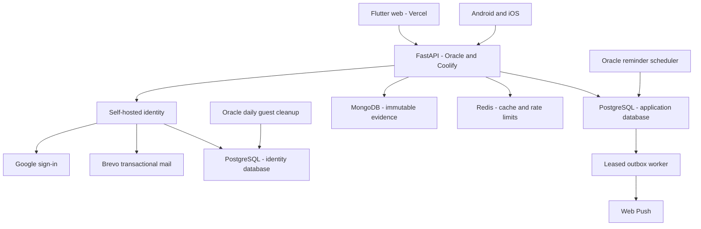

# Self-hosted platform

This is the replacement architecture. The [roadmap](../roadmap.md) distinguishes
verified foundation work from incomplete modules and cutover gates.

## Service and data ownership

Both PostgreSQL databases share one server, with separate roles and connect
permissions. Accounts, profiles, private libraries, catalogue projections and
durable jobs belong to the app database; passwords and sessions belong to the
identity database. App code cannot read password hashes. Guest cleanup has
EXECUTE-only access to a fixed maintenance function.

MongoDB retains original evidence with schema checks, content hashes and
append-only privileges. PostgreSQL keeps indexed projections and admission/outbox
state. Cross-store effects are idempotent, not atomic distributed transactions.

Redis owns expiring public caches and rate limits. Its loss cannot lose user
data or committed jobs. PostgreSQL jobs use leases, fencing, bounded retries and
visible failed state. A separate Redis queue is unnecessary. External delivery
remains at-least-once across provider failures.

## Identity

GoTrue supplies email/password, Google and session rotation/revocation. Fresh
accounts do not import Firebase UIDs, passwords or libraries. Collisions do not
merge accounts silently. Linking/deletion require owner and recent-auth checks;
no admin key enters Flutter.

Guest access JWTs expire after 15 minutes. Guests inactive for seven days become
eligible for daily cleanup. Active sessions, converted accounts and local scans
are protected. See [guest lifecycle](GUEST_SESSION_LIFECYCLE.md). Native refresh
credentials need secure platform storage; web redirects/recovery require exact
approved origins and expired-link tests.

## Operations

Coolify groups independently managed API, identity, worker, scheduler and database
resources. Databases have no public ports. Use resource limits, health checks,
bounded pools, timeouts and redacted logs. Application schedules run on Oracle.
Public host and resource references are in
[production configuration](../../infrastructure/production/resources.json).

One VM remains one failure domain. Configure encrypted off-VM backups and rehearse
restoration. A successful build is not security proof: dependency findings need
fixes or explicit applicability review.

After verified client cutover and recovery proof, retire the old Vercel backend
and Firebase resources/adapters. Preserve the Vercel frontend, required Google
OAuth clients, public source bundles, licenses, contract fixtures, historical
tags and local guest data. See [deployment](../deployment.md).
