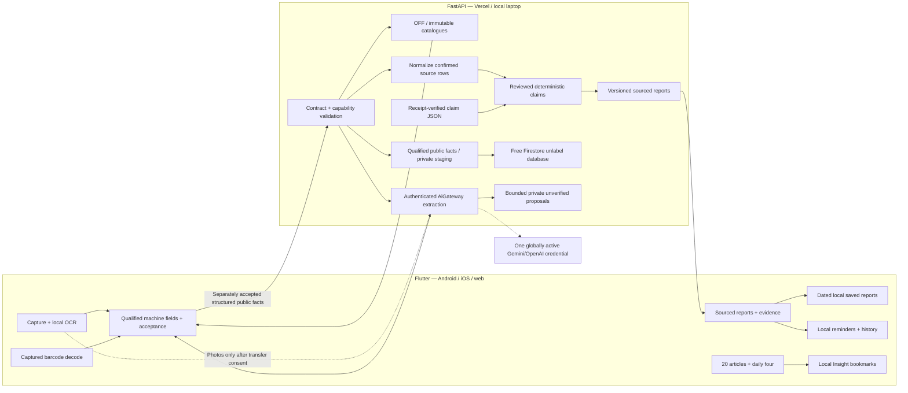

# System architecture

Updated **12 October 2026** against backend **v0.12.0** and frontend
**v0.7.0+11**. The backend exports **27 paths / 28 operations**. Automatic
captured-barcode reading, local OCR, optional consented cloud extraction,
sourced comparison and private account sync are implemented. Insights contains
twenty sourced articles, a shared date-stable daily four and local bookmarks.

The latest frontend implementation is pushed; its hosted proof remains pending.
Backend v0.12.0 has its separate READY receipt and 389 read-only hosted checks;
authenticated hosted extraction/staging is outside that audit. See the
[frontend review](../planning/FRONTEND_V0_7_0_REVIEW.md),
[backend review](../planning/BACKEND_V0_12_0_REVIEW.md) and
[master plan](../planning/MASTER_PLAN.md).

## Product and delivery boundary

One Flutter project in `frontend/` targets Android, iOS and web. Two Vercel
projects serve the static Flutter website and shared FastAPI backend. Native apps
call the same API; a laptop supplies an optional local demo backend. Keep the
project at **₹0 additional platform cost, no credit card and no billing upgrade**.

Fresh lookup and deterministic analysis require the backend. OFF, the preserved
bulk snapshot and the separate research catalogue supply qualified source facts.
Python applies seven reviewed numerical claim criteria; a separate six-entry
English/Hindi glossary explains technological functions. Dietary/allergen choices
are local reminders. Broader ingredient coverage, suitability, notifications,
continuous live decoding/highlights and physical-device accuracy remain gates.
No custom model is trained and no second Dart regulatory evaluator is required.

## Implemented component boundaries

Private account sync is separate from public observations and AI staging.
Machine facts never become confirmed package observations automatically. AI
extracts bounded fields; deterministic claims retain their own admission.

| Boundary | Responsibility |
| --- | --- |
| `frontend/lib/core/capture` | Permissions, capture lifecycle, barcode checksum/identity, OCR, geometry and local fallback |
| `core/models`, scanner presentation | Qualified extracted/source reports, acceptance, reader/detail views and source/version states |
| `core/network` | Bounded requests, capability handshake, cancellation and short-lived public read caches |
| `core/storage`, `core/accounts` | Dated local libraries, guest/UID isolation and explicit private-sync conflict choices |
| Device profile preferences | Local dietary/allergen reminders with corresponding symbols; no suitability verdict |
| `backend/app/catalogue`, `research_catalogue` | Independently verified read-only source stores and bounded search |
| `backend/app/claims`, `reports` | Reviewed numerical criteria, useful reports and six sourced ingredient functions |
| `backend/app/community` | Immutable observations, deduplication, qualified compatible facts and unresolved conflicts |
| `backend/app/ai` | Consented scanner extraction, global credential selection, cooldowns, quotas and private proposals |

## Evidence, source and privacy contracts

`knowledge/` contains the canonical seven-claim criteria and three reviewed source
records. The six-entry glossary lives separately in
`backend/app/reports/glossary-v2.json`; its artifact is independent of the claim
receipt. Source-tagged OFF/research facts do not certify today's physical package.
Missing, conflicting or unsupported inputs remain `insufficient_information`.
There is no health score, allergy-safety inference or complete legal verdict.

Preserve original/corrected provenance, panel completeness and nutrient bases.
Do not average incompatible tables or fill branded-packet gaps with generic-food
composition. Captured photos stay local unless transfer is explicitly consented;
photos, raw OCR and geometry stay outside database/account sync. Private machine
staging retains only bounded literal structured facts, with separate storage
outcomes. [AI privacy/admission](AI_ROUTING.md).

Guests keep personal reports locally. Optional password accounts may sync bounded
private display name/saved/history snapshots with explicit cloud/device conflict
choices. Reminders, appearance, Welcome completion, photos/raw OCR and Insight
bookmarks remain device-local. Public observations use separate anonymous or
password scanner ownership. Moderator state never establishes safety or current
package proof. [Private sync](PRIVATE_ACCOUNT_SYNC.md) ·
[Community catalogue](COMMUNITY_CATALOGUE.md) · [Privacy](../SAFETY_PRIVACY.md).

## Build, runtime and offline boundaries

The network-free backend build validates tracked sources, generates ignored
SQLite/receipts and packages two approved claim JSON files with their receipt.
Hosted startup verifies artifacts before enabling their independent capabilities.
Invalid catalogue/knowledge disables affected routes; health and unaffected
sources remain available. Research catalogue and image descriptors retain their
own provenance. Packaged files are immutable; instance caches and temporary
storage cannot hold durable user data. [Catalogue build](CATALOGUE.md).

`BACKEND_BASE_URL` is public configuration. Provider keys and the AI control
secret stay server-only. `AI_ENABLED` gates the optional gateway. Extraction
requires verified Firebase scanner tokens and consent; selection/activation uses
the separate machine credential. CORS is not authentication. Firebase's Standard
`unlabel` database stays on the free tier without linked billing or paid fallback.

| Mode | Behavior / boundary |
| --- | --- |
| Backend reachable, AI unavailable | Qualified product facts, reviewed reports and local OCR fallback |
| Optional AI available | Consented extraction proposes unverified fields; deterministic confirmation stays separate |
| Backend unreachable | Dated saved reports, local reminders, bundled Insights and supported local capture; fresh analysis waits |
| Local backend reachable without internet | Confirmed fields can use packaged rules; uncached OFF/cloud reads remain unavailable |
| Website offline | First-load, app caching and airplane-mode restart require separate verification |

Android uses bundled ML Kit, iOS uses the capability-checked Vision bridge and
browser OCR uses pinned same-origin Tesseract/Wasm/language assets. Source/widget
checks do not prove native accuracy, response time, offline website restart or
authenticated hosted AI behavior. [Deployment gates](DEPLOYMENT_PLAN.md).

## Historical release context

Frontend v0.3.0+4 was independently published/hosted-verified. Backend v0.8.0
implementation `1a2fd25b3f781ac916ca6fc1179883f81d5f40a8` was pushed and
hosted-verified with 25 checks; that receipt alone did not establish source-release
publication. The subsequent v0.9.0/v0.4.0 reviews retain their dated scope.

The independently released v0.2.3 slice established the export-origin rich-facts
catalogue and verified hosted SQLite/receipt. The preserved v0.3.0 claim subset
uses original confirmed rows and statutory fibre energy conversion **4.2 kJ/kcal**;
normalization-v1 retains **4.184**. Nine-calendar-month source replacement creates
an immutable deployment with prior-source rollback. These historical identities
and receipts remain in their release reviews; they do not replace current proof.
