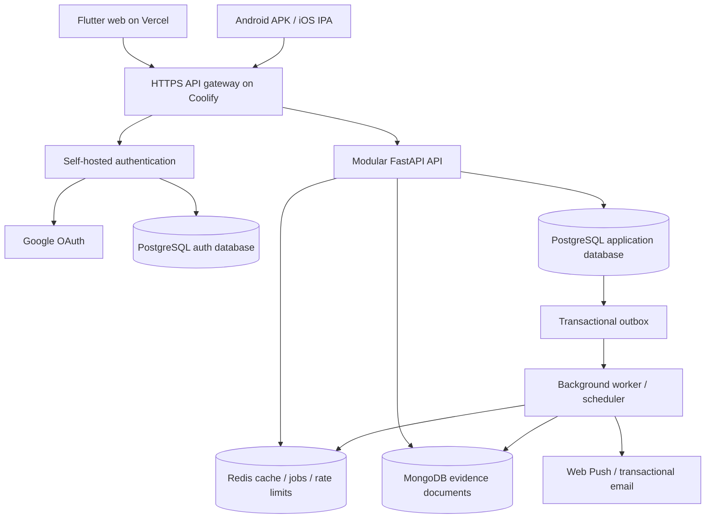

# Unlabel self-hosted architecture rebuild

Date: 14 November 2026. Status: next-major direction accepted. Ship frontend
0.12.0+17/backend 0.16.0 first; implementation begins afterward. No cutover in
the current release. Target next major: frontend/backend 1.0.0 (native build
number advances from the then-published canonical build).

## Scope and latest decisions

The user explicitly replaces the earlier hosting and storage decisions:

- Vercel hosts the Flutter web frontend only.
- Coolify on the existing Oracle VM hosts the API, authentication, databases,
  background workers and operational services as one Unlabel project.
- No Firebase runtime or SQLite runtime remains in the finished architecture.
- Existing Firebase accounts and database contents can be discarded. This is a
  clean account launch, not a password/identity migration. Google sign-in remains.
- Keep the acquired public source bundles, licenses, source receipts and static
  research observations. Device-local guest records are not Firebase data and
  are outside the discard scope.
- Preserve the requested UI overhaul, functioning notifications, unsubscribe,
  responsive renders and source/asset optimization work. Work stays on main.

No hosting cutover or Firebase data deletion has happened at this checkpoint.
The UI and initial notification implementation are uncommitted work. Their first
Firestore/Vercel-scheduler implementation will be replaced by this architecture.

## Target deployment



One Coolify project, independently manageable services, private database network,
persistent volumes, explicit CPU/memory limits, readiness/liveness checks and
versioned configuration. The frontend uses same-origin proxy routes to the API
where needed for secure web sessions; native clients use the HTTPS API directly.
The authentication service owns its PostgreSQL database and separate credentials.
Only the gateway/API and required auth routes are public.

## Storage ownership

| Store | Authoritative responsibility | Boundaries |
| --- | --- | --- |
| PostgreSQL application DB | Accounts, profiles, private library sync, catalogue/product search, nutrition tables, notification preferences, job/outbox state and audit metadata | Constraints, migrations, owner isolation, revision checks and indexed search; no SQLite service or runtime catalogue file |
| PostgreSQL auth DB | Authentication users, linked identities, sessions and recovery tokens, owned by the auth service | Distinct role/database; no application access to password hashes |
| MongoDB | Immutable research/community/machine observations and their source documents, conflicts and provenance | Content hashes, schema/version validation, append-only observations; explicitly bounded provisional retention; no account/password ownership here |
| Redis | Short-lived public caches, distributed rate limits, queue transport and worker coordination | Cache loss cannot lose authoritative user data; expiry and queue limits; durable job intent stays in PostgreSQL |

PostgreSQL JSONB remains appropriate for bounded application metadata. MongoDB
owns the document evidence domain rather than duplicating the account database.
Cross-store work uses an outbox and idempotent consumers, not an assumed atomic
transaction across PostgreSQL/MongoDB/Redis. Workers acknowledge only completed
effects and expose failed jobs with bounded retries/backoff.

## Authentication replacement

Use an established self-hosted identity service with email/password, Google,
session rotation/revocation, password recovery and explicit provider linking.
Supabase Auth/GoTrue in standalone mode is the leading implementation candidate;
validate the pinned release, Google ID-token/linking APIs and native/browser
session flows in a spike before committing the final adapter. This is a
self-hosted auth component, not a new hosted Supabase dependency or the complete
Supabase suite.

Fresh users receive fresh identities and empty private libraries. Old Firebase
passwords, sessions and UIDs are not imported. Preserve useful guest workflows.
Google credentials and authorized origins remain a separate Google Cloud OAuth
configuration; deleting a Google Cloud project would also break those clients.
No automatic credential-collision merge. Account deletion and provider changes
retain recent-auth checks and last-provider protection. Browser session cookies
need Secure/HttpOnly, CSRF protection and a same-origin flow; native refresh
credentials use OS secure storage. No administrative auth key enters Flutter.

Password-reset email is part of the acceptance criteria and needs a working
transactional mail transport. Reset links and recovery states replace the old
Firebase action-handler contract and must be tested, including expired links.

## Backend modules

Use a modular monolith deployed as an API process and worker process:

```text
backend/app/
  modules/
    auth/ accounts/ profiles/ catalogue/ evidence/
    scanning/ comparison/ notifications/
  platform/
    config/ database/ cache/ jobs/ security/ observability/
  integrations/
    open_food_facts/ nutrigraph/ gemini/ openai/ google/ email/
```

Each module owns its routes, request/response models, application services and
repository interfaces. Storage adapters and provider clients do not own domain
decisions. API and worker share those services. Retain typed failures, timeouts,
bounded requests, deterministic evidence rules and versioned contracts. Remove
retired Firebase/SQLite runtime adapters after replacements pass their checks.
Preserve source acquisition tools and licenses as historical/provenance inputs.

## Execution order and gates

1. **Inventory and design:** finish the source/asset/API/storage audit, inventory
   live VM capacity and service limits, establish data ownership and write ADRs.
   Record the clean-start Firebase decision and the public data that must remain.
2. **Infrastructure foundation:** create the isolated Unlabel Coolify project,
   private network and stores; validate TLS, secrets, readiness and resource
   limits. Add reproducible Docker builds and local container development.
3. **Schema and import:** apply versioned PostgreSQL/document migrations, import
   the committed catalogue and research sources directly, compare counts and
   content hashes, and test search/report parity. No generated SQLite is needed
   in the new runtime. Catalogue acceptance includes 24,641 bulk products and
   243 retained static research observations; image descriptors remain separate.
4. **Auth and private data:** connect the new identity service, owner-scoped
   account/profile/sync APIs and web/native adapters. Verify fresh email/Google
   accounts, provider linking, recovery, sign-out/revocation and owner deletion.
5. **Domain services:** port source resolution, comparisons, observation
   admission, deduplication, immutable receipts and optional provider controls to
   the new repository boundaries. Test isolation, races and failure behavior.
6. **Jobs and notifications:** run worker/scheduler separately. Web uses VAPID
   Web Push and real subscriptions; APK/IPA use their native OS scheduler for
   opted-in daily reminders. All platforms have the inbox, permission handling,
   delivery tests, time preferences and explicit unsubscribe. Subscriptions,
   retries, dead jobs and cancellation are observable. Native remote push beyond
   these reminders is a separate APNs/Android transport decision, not implied by
   a working inbox or scheduled notification.
7. **UI completion:** finish charcoal/glass tokens, larger typography, compact
   useful card layouts, profile/settings, auth, lower safe-area-aware navigation,
   reduced motion and haptics. Render phone, tablet in both orientations and
   laptop widths in both themes, including enlarged text and error/empty states.
8. **Operational proof:** run unit/integration/API tests against real container
   stores, concurrency and fault tests, migration checks, load measurements,
   dependency/secret checks and backup/restore rehearsal. Preserve evidence and
   source boundaries; do not invent product or health facts.
9. **Release and cutover:** update docs/contracts/version metadata, deploy and
   test the replacement behind its final HTTPS routes, publish the frontend and
   native artifacts, then switch clients. Verify hosted flows. Retire Firebase
   data/auth only after the replacements and rollback procedure are proven.

## Operations and recoverability

- Structured redacted logs, request/job IDs, health/readiness endpoints and
  actionable alerts. Record latency, error rates, pool/queue pressure and disk.
- Least-privilege DB roles, private DB ports, bounded pools, explicit timeouts,
  startup validation, secure headers and rate limits that include auth routes.
- Pinned images/dependencies; migrations and deployment checks in CI; production
  runtime configuration is separate from development and synthetic test data.
- Automated encrypted database backups outside the VM and periodic restore
  tests. Local same-VM snapshots alone do not protect against VM/disk loss.
- Proposed starting objectives: recovery point within 24 hours and recovery time
  within 4 hours; measure and revise after a real restore drill.
- One VM is one failure domain. Multiple containers improve separation and
  management, but do not establish high availability. Multi-host replicas,
  failover and independent database nodes are a later capacity/reliability step.
- Document deploy/rollback, schema changes, source refresh, secret rotation,
  account deletion, failed jobs, backup/restore and incident triage.

## Current work and remaining proof

Current-release verification passed 532 Flutter tests, 1,503 backend tests
(5 external integration skips), 37 web checks and 19 script checks. Affected
final auth/notification/artwork checks passed 68 tests and the analyzer is clean.
Web release build and isolated-cache Android debug compilation passed. Hosted
publication, iOS CI and physical-device notification delivery remain separate
checks. This evidence belongs to the current release, not the major rebuild.

Better Design calls were attempted for design/review/spacing but the account's
monthly quota prevented results. Render/source checks are not a tool approval.

Safe optimizations already prepared include larger readable typography, neutral
charcoal glass, profile email separation, moving sync into Settings, compact
statistics, narrower-screen layout repairs, reduced artwork warmup, removing
unused runtime font registrations, lossless auth WebP and a derived wordmark-only
font. Original source assets/licenses are retained with hash provenance.
