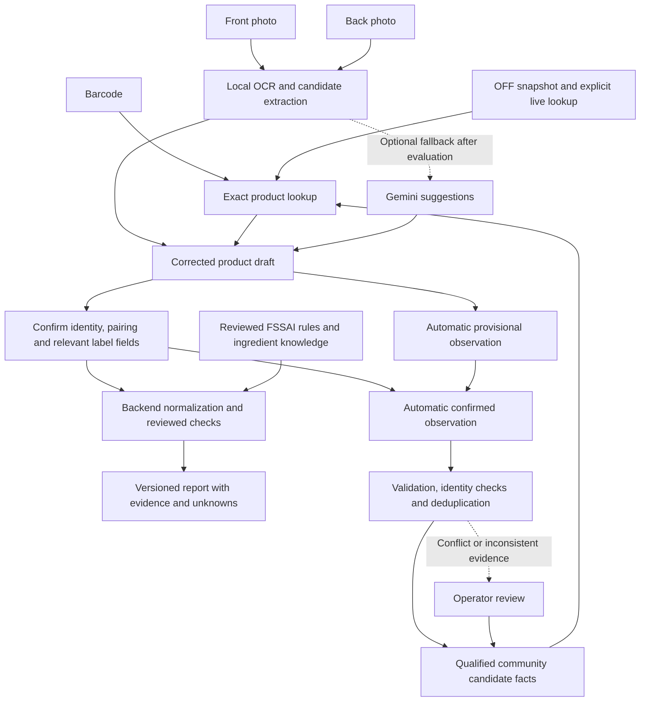

# Unlabel master plan

Active versions come from [frontend pubspec](../../frontend/pubspec.yaml) and [backend pyproject](../../backend/pyproject.toml). Current scope: [reference auth and account controls](FRONTEND_V0_9_0_REVIEW.md) and [private account deletion](BACKEND_V0_13_0_REVIEW.md); preceding source reviews retain their dated evidence.
This document records product intent and contracts. Current delivered capabilities
and unavailable gates are in [the feature tracker](FEATURE_TRACKER.md); immutable
source identities are in [the release ledger](CONTROLLED_RELEASES.md).
The active task extends [maintenance](MAINTENANCE_2026_10_12.md) with the
user-authorized auth/profile scope: four app auth states, Firebase-hosted reset,
same-UID Google/password linking, private thumbnails and optional gender/default avatars. Unset
gender uses the approved male default; no Google gender inference is permitted.
The latest auth references require a fixed outer viewport, equal non-scrolling
desktop cards and a whole mobile card moving over fixed artwork. Portrait iPad
fills the width; landscape uses the desktop composition. [Account/profile contract](../architecture/ACCOUNT_PROFILE.md). Final
current-source hosted/native acceptance remains pending. On 13 October the user
authorized completion and push on main, superseding the earlier local hold.
Login/signup use layered mascot/sprout/themed-garden illustrations and responsive
forms; sign-in methods add provider management and explicit account deletion.
Dated release slices below retain their own evidence and scope.

## Product goal

Help someone understand an Indian packaged food using a barcode, a back-label
photo, a front-package photo, or a combination. Provide useful findings even
when the product database is incomplete. Explain what the evidence supports,
what is missing and what the person needs to confirm. Let ordinary scans
improve shared coverage automatically with captured and corrected public package
facts. The user explicitly rejected a separate optional sharing action.

The five concept screens cover 20 feature groups, not 20 equally sized tasks.
Their example 85/100 score, claims and recommendations are illustrative.
A universal health score is not a requirement for the first useful product.
Keep the project at ₹0, with no card or linked billing account.

## Architecture decision

Use one **product draft**, one source-preserving facts layer and one deterministic
report pipeline. Keep the existing Flutter client and modular FastAPI backend.
Use the existing OFF snapshot and reviewed FSSAI knowledge. Add a small,
separate community catalogue for automatically saved package observations. Begin
extraction with pretrained local OCR and correction. Do not train a custom model now.
Consider Gemini only for an extraction problem that a measured comparison shows
it solves substantially better.

| Approach | Benefit | Cost or limitation | Decision |
| --- | --- | --- | --- |
| Existing OCR, exact lookup, reviewed data/rules | Predictable baseline; no AI request for ordinary scans; manual path always works | Difficult images need correction; language support varies | Build this first |
| Same baseline plus occasional Gemini extraction | May handle difficult layouts or mixed text better | Remote image disclosure, quotas and invented values need controls; benefit unmeasured | Optional, disabled until benchmarked |
| Custom model and automatic training now | Could improve a specific repeated extraction failure | Needs suitable annotations, a baseline, independent Indian evaluation and deployment support | Defer; insufficient evidence of need |

## What each entry path can establish

| Input | Useful outcome | Required confirmation or missing evidence |
| --- | --- | --- |
| Barcode | Exact packaged-product candidates, dated identity and available facts | Current name/variant/quantity when records differ; missing facts need the label |
| Back photo, with or without barcode | Ingredient/declaration text and nutrient-table candidates; partial report after correction | Values, units, column basis, serving quantity and preparation; a barcode is not required for private analysis |
| Front photo | Name/brand/variant, quantity and printed claim candidates; later bounded product search | Candidate identity and front/back pairing; front claims alone cannot establish nutrition or ingredients |
| Barcode plus paired front/back evidence | A more complete confirmed draft; automatic catalogue enrichment | Same actual package, captured fields and evidence state |

Do not reject a private analysis because there is no catalogue match. A back
label is the main route around missing database facts. A front-only result may
identify a product or explain what further evidence is required; it must not
invent a complete report.

Initially, barcode/manual entry and corrected structured label input establish
the backend contract. Camera/OCR belongs to client integration. Native Latin
and Devanagari recognition are first candidates; broader Indic scripts and web
OCR require separate testing and model selection. Do not claim all-India OCR
support from a library's total language count.

## Multiple sources, with distinct purposes

| Source | Use | Admission boundary |
| --- | --- | --- |
| Current person's corrected package | Current analysis and automatic catalogue enrichment: declared ingredients, allergens/traces, front claims and nutrient rows | Preserve confirmation, completeness and original table context; exclude private user data |
| Open Food Facts | Exact barcode identity, images as attributed URL descriptors, available direct package facts and separate provider scores | Retain origin/date/license; existing legacy aggregate exclusions remain; cache/snapshot miss is not a factual zero |
| Unlabel community catalogue | Automatically captured missing or updated public package observations, linked to exact barcode and identity when established | Provisional first, immutable content hash, explicit submitter/review state, dated revisions and conflicts |
| Official manufacturer/package source | Complement missing identity, ingredient or nutrition fields for an exact product | Verify official source, reuse rights, GTIN/market/variant/quantity and label context; name-only matches stay candidates |
| Reviewed FSSAI sources | Criteria for supported claim types and selected ingredient/additive context | Applicable reviewed rules and sufficient confirmed evidence; not a consumer barcode database or certification |
| ICMR-NIN IFCT | Possible future Indian raw-food reference | Separate generic-food feature; verify reuse rights before acquisition/import |
| INDB | Possible future common Indian recipe/dish reference | Recipe composition is not the contents of a branded packet; verify redistribution rights |
| USDA FoodData Central | Possible future generic-food gaps; separately qualified exact branded records where appropriate | Do not infer an Indian packet's values from a similar food, name or ingredient |

Start with **OFF + captured/corrected label facts + community observations +
reviewed FSSAI knowledge**. Add manufacturer records selectively when they
provide exact compatible evidence and permitted acquisition. Importing IFCT,
INDB and USDA wholesale does not solve the
packaged-product gap and is outside the first useful release sequence.
The [coverage strategy](../research/INDIAN_FOOD_COVERAGE.md) records source roles
and acquisition constraints. INDB describes recipe composition, while USDA
distinguishes generic and branded datasets. [INDB](https://www.anuvaad.org.in/indian-nutrient-databank/),
[USDA data types](https://fdc.nal.usda.gov/data-documentation/).

Keep reusable acquisitions deterministic: bounded download, real byte/stage
progress, license/source metadata, full hash, validated conversion and atomic
replacement. Reuse the already acquired OFF source; do not download it again.
Keep snapshots replaceable on the existing nine-calendar-month manual schedule.
OFF data/image attribution survives use alongside community assertions.
[OFF licensing](https://openfoodfacts.github.io/documentation/docs/Product-Opener/api/tutorials/license-be-on-the-legal-side/).

Acquire in this order: reuse the snapshot → selectively fetch newer OFF direct
facts → automatically accumulate corrected package observations → add permitted
exact manufacturer facts → evaluate the overlap with eligible USDA Branded
records. OFF live and the OFF snapshot are one upstream source, not independent
votes. USDA nutrient derivations require checking; per-100 g provider values can
be converted/calculated rather than a directly printed label row.
[USDA branded documentation](https://fdc.nal.usda.gov/docs/Branded_Foods_Documentation_Apr2024.pdf).

No comprehensive free manufacturer feed or measurable added coverage from these
supplementary sources was established. GS1 India DataKart solution-provider
access requires fees, so exclude it from this no-card/no-cost architecture.
[DataKart provider access](https://www.gs1india.org/datakart/datakart-for-solution-providers).

## Filling missing fields through compatible source merging

1. Resolve exact barcode identities from the OFF snapshot and accepted community
   revisions. Existing live OFF lookup remains an explicitly selected bounded
   network operation; preserve its separate retrieval origin and failure state.
2. Present compatible candidates for correction and current-package confirmation.
   Name similarity, an identical brand or a visually similar front is not enough
   to establish the exact variant, quantity or reformulation.
3. Build one **resolved product view** that can complement missing fields from
   compatible sources. Preserve every original observation/table behind it;
   the frontend should not have to assemble several raw datasets itself.
4. Each resolved field retains its value/context, selected source, date, evidence
   state, selection reason and conflicting alternatives. Explicit zero is known;
   an absent field is eligible for a compatible known value from another source.
5. Require exact product identity and applicable market first. Known variant,
   quantity, form or reformulation disagreement separates candidates. Unknown
   revision compatibility cannot justify manufacturing a complete nutrition panel.
6. Select ingredients as an ordered whole section. Never concatenate two partial
   lists or assume two formulations contain their union. Keep declared contains
   and may-contain separately; missing/not-observed does not prove absence.
7. Supplement nutrient cells only with compatible product revision, preparation
   and denominator. A measured serving conversion is possible with explicit
   arithmetic; 100 g and 100 mL remain separate without sufficient evidence.
   Preserve per-cell and original-table lineage; a complemented view is not one
   observed table. Do not average conflicts or pick the favourable value.
8. Confirmed current-package rows drive current-label checks. Supplementary
   historical values can be shown with their source but cannot become that
   confirmation automatically. Incomplete/current conflicting evidence keeps
   the affected rule insufficient rather than turning the display into proof.

Minimum candidate qualification requires exact identity and relevant same-package
pairing, permitted per-field origin, relevant field confirmation/completeness,
successful normalization and compatible table context. A known exact barcode
alone cannot establish reformulation compatibility. Unknown revision context
remains an alternative; two conflicting eligible unreviewed values produce a
conflict, not a winner chosen by arrival order. The resolved field retains the
submitter-confirmed/unreviewed state even after a missing display field is filled.

There is no single universal source ranking: the current label is most relevant
to its declared values; FSSAI provides rule evidence; a generic composition table
describes its own food. None can substitute for the other's purpose. Direct
current manufacturer labels, accepted community assertions and OFF direct facts
are useful candidates; date and evidence context matter more than a fixed brand
ranking. Known conflicts require resolution, not silent selection.

For example, suppose compatible exact packet evidence gives OFF identity/image,
a corrected back-label ingredient section, and a direct matching manufacturer
nutrition table. The product view can expose all three useful parts with their
own origins. If OFF lacks fibre but a confirmed current table declares 7 g/100 g,
that declared value fills the resolved field. IFCT's generic oats fibre cannot
fill the packet field; neither can another flavour's table or an as-prepared
column mistaken for as-sold.

Licenses remain attached to source records and derived views/exports must respect
applicable terms. Keeping stores separate does not relicense OFF-derived content
as CC0. Track new useful fields per exact product rather than adding source row
counts; overlapping sources may add no coverage at all.

## Reports the frontend can actually use

One future report contract should serve all entry paths. It contains identity
and unresolved identity issues, original tables plus a resolved nutrient view
with per-cell provenance,
normalization/basis, deterministic findings, claim verdicts with rule/evidence
references, declared allergens/traces, reviewed ingredient entries and specific
missing inputs. It also contains backend/report/knowledge versions and dates.

Return **partial useful results** when evidence is incomplete. Separate total
and added sugar. Sugar cubes are a declared approximation derived from a stated
mass per cube, not an independently measured health result. Unknown ingredients
stay unknown; an unfamiliar chemical name is not automatically a danger.

Reuse the existing normalizer and seven reviewed numeric claim checks. Start a
small reviewed ingredient glossary with encountered common terms and INS aliases;
extend it from measured unknowns, with reviewed English/Hindi descriptions.
Use templates for ordinary explanations. Preserve OFF Nutri-Score/NOVA as OFF
insights instead of presenting them as an invented Unlabel score.

Later comparison consumes two reports and compatible nutrient bases, shows
missing values and explains individual differences. A universal winner or score
needs a separately justified method. Saved products/history retain dated reports
locally for guests; optional signed-in libraries and private profile thumbnails
use the separate account contracts. Dietary/allergen preferences remain device-local.
Frontend v0.7.0 introduced twenty reviewed
editorial insights with a shared daily controller, full readers, matching art
and device bookmarks, without AI or a separate feed service.

## Growing coverage responsibly and cheaply

Public package facts are saved automatically; there is no separate Share button
or per-scan sharing opt-in. Explain once in the product that structured package
facts improve Unlabel. Anonymous authentication can occur transparently for
background saves. Analysis remains usable if saving/authentication/quota fails;
preserve useful local reading instead of blocking the report. Public submissions
have immutable retry identity, without a persisted generic public outbox or
automatic uncertain-write replay.

Automatically retain recognized field drafts at meaningful scan boundaries:
a completed front/back capture, a linked identity or a committed correction.
Coalesce intermediate OCR updates; do not issue database writes per frame,
keystroke or rendered draft. Save corrected confirmations as immutable revisions.
Use an outbox of at most three unsaved drafts with bounded retries. Server staging
shares admission/storage limits and allows at most ten unmatched records per
subject; unmatched records cease candidate eligibility after seven calendar days.
Bounded operator cleanup removes expired staging without paid TTL/Functions.
Do not save camera frames,
raw OCR dumps, personal profiles, location or private history. Automatic factual
storage is not permission to publish or train on private photos. Preserve the
original source license; only eligible original assertions use the community
factual license.

Every submitted section/table identifies its origin: provider-prefilled reference,
independently transcribed package, or permitted manufacturer evidence. Confirmation
does not erase the original origin or grant a new license. Reference already
stored provider records rather than copying them into new CC0 assertions. Keep
field confirmation separate from origin and moderator review.

An observation progresses from **unmatched/provisional → submitter-confirmed →
eligible candidate**, or to needs-correction/conflict/rejected. Moderator review
is an additional evidence state. Known barcode/front/back links bind
it to an exact candidate. Barcode-less structured observations can be staged
under an observation ID but cannot enter exact public lookup until identity is
established. OCR guesses and malformed table interpretations stay unverified.

Confirmed barcode/front identity/back facts enter validation automatically.
Retried identical observations return the same receipt; changed content creates
an explicit revision or conflicts with a reused immutable request ID.
Deduplicate semantic facts within an exact product/context: exclude transport
request IDs, row IDs and observation timestamps from duplicate identity while
retaining original payload hashes/dates for provenance and private receipts.
Keep bounded last-seen metadata rather than an unbounded list or a write on every
identical scan. Repeated observations do not constitute accuracy votes.

The factual fingerprint is separate from the observation/revision identifier.
Reuse duplicate facts only within an active compatible revision context; retain
observation dates and scoped review decisions independently. If a product changes
**A → B → A**, the new A may reuse factual content but needs a new revision
association and cannot inherit old supersession/review state. Duplicate receipts
still consume writes, so they also need bounded admission; factual deduplication
does not create an unlimited free receipt stream.

For efficient growth, strictly validated submitter-confirmed facts that fill a
compatible gap may enter candidate lookup automatically, explicitly labelled
**submitter-confirmed; not moderator-reviewed**. They cannot overwrite contradictory
known facts or become the current caller's confirmation. Hold conflicts,
identity mismatch and anomalous evidence for operator review; raw/unmatched
observations are not exact public product facts. Operator review accepts/rejects
the exact content hash and can supersede a compatible revision. Private receipts,
tokens and ownership identifiers are never public. This qualified candidate policy is implemented in v0.4.0; review never replaces
current-package confirmation.

Structured-only review can check plausibility and consistency but cannot
independently verify transcription against an absent original image. Label it
**moderator-accepted community assertion**. Measure review turnaround and useful
fields added; do not count submissions as verified products. Do not automatically
publish unconfirmed OCR or Gemini outputs, or infer trust from repeated identical
submissions. Mandatory approval of every identical rescan is unnecessary; focus
review effort on identity, conflicts and quality problems.

Firebase display name is **Unlabel**, project ID `unlabel-india-catalogue`; its
first Standard database **`unlabel`** is configured in **Mumbai/asia-south1** with
free tier enabled and no linked billing. Anonymous Auth, denied direct client
access and dedicated least-privilege backend credentials are configured. Live
synthetic persistence/retry/review/cleanup and direct REST denial were checked;
hosted API verification passed separately with sixteen HTTP checks and matching source receipts.
Keep Spark, deny direct client database access and use explicit backend credentials.
No Cloud Storage, Cloud Functions, paid billing, paid fallback, TTL or paid backups.
The first database receives free quota regardless of its ID; hard quotas can
interrupt availability. [Firebase plans](https://firebase.google.com/docs/projects/billing/firebase-pricing-plans),
[Firestore pricing](https://firebase.google.com/docs/firestore/pricing).

Keep API/provider timeouts and admission limits bounded. v0.4.0 public lookup
uses no per-read write counter. Prefer bounded reuse of public lookups where safe,
with explicit freshness and invalidation. No real-time listeners or public
moderation dashboard are needed initially. Existing OFF/rules/manual paths
must survive community quota or provider failure.

The app has one identity role: the scanner/client user. Anonymous authentication
runs automatically for factual writes. Do not create admin/reviewer app accounts,
custom role claims or a dashboard. The backend service account is a machine
credential, not a human login. Existing exact-hash CLI operations are manual
maintenance; safe compatible observations qualify automatically and known
conflicts remain unresolved rather than making all scans wait for a reviewer.

## AI decision and the role of a Gemini key

**Custom training is deferred.** The missing evidence is currently a working
capture/parser baseline and an independent Indian-package benchmark, not GPU
access. A model will not discover reliable nutrient facts absent from all inputs.

The investigated OFF nutrient-layout dataset has **2,884 training and 199 test
examples**, about **635 MB** of download, under its stated **CC-BY-SA 3.0** license.
It annotates nutrient value/unit tokens and relies on prior OCR. It does not
provide a ready general ingredient/front-identity OCR solution or establish
Indian-language performance. [Dataset card](https://huggingface.co/datasets/openfoodfacts/nutrient-detection-layout).

A Gemini key may earn a place for difficult table/text extraction after the
baseline is measured. The proposed policy is:

- Disabled by default; no Gemini calls for exact barcode lookup, arithmetic,
  claim thresholds, normal explanations or community review.
- Explicit person-approved crop submission for difficult extraction only;
  exclude personal/background details. Keep the key backend-only.
- Use a currently eligible free-tier stable vision model, with billing absent;
  bounded request size, one attempt, application budget and safe quota fallback.
- Cache equivalent permitted requests by content/model/prompt version where
  appropriate, without retaining private photo bytes or exposing them across users.
- Validate output shape, units/bases and cited visible text; all returned facts
  are correction candidates requiring confirmation. Schema-valid JSON is not
  proof of semantic accuracy.
- Retain manual/local extraction when remote inference fails. Free-tier Gemini
  data handling must be disclosed before crop submission; it is not a private
  image-processing guarantee. [Gemini pricing/data use](https://ai.google.dev/gemini-api/docs/pricing),
  [structured output limits](https://ai.google.dev/gemini-api/docs/generate-content/structured-output).

The current small stable candidate is documented as `gemini-3.5-flash-lite`;
recheck model eligibility, image pricing and limits at integration time instead
of treating this dated selection as permanent. No key, account billing change,
API call, model download or training is required for this planning checkpoint.
[Official model](https://ai.google.dev/gemini-api/docs/models/gemini-3.5-flash-lite).

## Measurement gates before adding complexity

Start with a permissioned, independently corrected set of **200 Indian packaged
products across 20 categories**, including regional brands, bilingual panels,
different columns/preparations and difficult photos. This is an initial benchmark,
not proof of all-India coverage. Expand script cohorts separately; split evaluations
by product/package family to avoid duplicate leakage.

Track exact identity/variant errors, ingredient/declaration transcription,
nutrient-value/unit/basis tuples, missing-data rejection, correction time,
latency and failure rates. Include unreadable panels and incomplete evidence.
Keep private images outside Git and outside shared facts/training unless separately
licensed and authorized.

The user authorized a bounded optional Gemini/OpenAI prototype on 8 October,
with explicit consent and qualified output. The earlier proposed benchmark gate
below remains an accuracy evaluation target rather than a prohibition on that
authorized prototype. Validate the fallback using a blinded difficult-image
comparison that shows at least **20% less median correction time**, no regression on ordinary
cases, acceptable latency and no increase in wrongly accepted identity/unit/basis
facts. Human confirmation remains required. These are proposed acceptance criteria,
not measured results.

Consider a custom model only after logs/benchmark identify one repeated task
that rules/OCR cannot handle and a rights-cleared annotated dataset covers it.
Then build one automatic pipeline: acquire/resume/check hashes and licenses →
prepare product-separated splits → train locally → compare against the baseline →
export a bounded checkpoint/model card → enable only if the gate passes.
Include real progress and cancellation, reproducible pins and resumability.
Do not build that pipeline speculatively now.

Coverage metrics count exact products and useful fields separately: products with
direct complete/partial nutrition, ingredients, declarations, accepted community
revisions, unresolved conflicts and outcomes by category/script. More database
rows alone do not measure useful Indian-market coverage.

## Delivery order and completion gates

Historical backend v0.4.0/v0.5.0/v0.6.0 and frontend v0.1.0/v0.2.0 remain
independently published with their original receipts. Backend v0.7.0 private sync
and frontend v0.3.0 Visual Label Reader are published and hosted-verified.
Backend v0.8.0 Sourced Nutrient Comparison is pushed and hosted-verified with
25 checks. Frontend v0.4.0+5 and backend v0.9.0 are independently pushed and
hosted-verified with 49 and 26 checks. Their source-release publication remains
separate from these completed implementation/deployment gates. [Accepted scope and checklists](ACCOUNT_SYNC_SCREEN_PLAN.md).
Finish each component release boundary before the next.

| Stage | Meaning and user value | Completion gate |
| --- | --- | --- |
| Published v0.3.0 foundation | Barcode facts, direct nutrition normalization and seven reviewed numerical claim types | Already released; preserve its tested contracts and source receipts |
| v0.4.0 Community Product Catalogue | Automatically saved observations and compatible sourced fields improve exact lookup | Four additive routes with revised observation/receipt schemas, semantic deduplication, qualified candidates, conflict review, resolved fields, free project/rules, transaction and hosted checks |
| Released v0.5.0 Useful Label Report | A barcode or corrected back label produces one understandable sourced report | Private intake without barcode; bounded ingredient/declaration fields; reuse normalizer/claims; reviewed glossary/templates; partial/unknown behavior |
| Released v0.6.0 Product Discovery | Front text helps find the right candidate without a readable barcode | Bounded indexed name/brand/variant search, ambiguous/missing states and identity confirmation; no visual certainty claims |
| Published v0.7.0 Private Account Sync | Optional scanner accounts sync their own personal records; comparison/insight destinations use useful sourced contracts | Verified account ownership, bounded private storage, guest privacy, merge/deletion/logout/conflicts; compatible facts without universal winner |
| Published frontend v0.2.0 Welcome, Home and Optional Login | First-launch Welcome and light/dark app journeys | Published exact source and hosted receipt; guest/account isolation; native gates separate |
| Published frontend v0.3.0 Visual Label Reader | Reference Welcome/Profile, app-only startup, local OCR and search/navigation performance | 168 tests, rendered light phone/PC checks, READY source deployment, 49 hosted checks and independent source release |
| Verified backend v0.8.0 Sourced Nutrient Comparison | Exact sourced/confirmed compatible tables with unknown/conflict handling | Independent push and 25 hosted checks complete; source publication separate |
| Verified backend v0.9.0 Reviewed Ingredient Functions | Six reviewed bilingual name/function entries and strict bounded source/alias matching | 1058 tests/five provider skips, clean static/contracts/build checks, independent push and 26 hosted checks |
| Verified frontend v0.4.0+5 Sourced Comparison and Ingredient Detail | Exact source/table selection, guarded comparison, bilingual evidence and parallel camera/gallery recovery | 181 tests, clean analysis/web build, responsive browser checks, independent push and 49 hosted checks; physical-device proof separate |
| Client integration alongside stable contracts | Barcode/manual scan, corrected front/back capture, results, automatic factual saving, local history/saved/preferences | Real-device/web OCR/camera tests, source/error/correction behavior and integration of each screen |

Do not require v0.6.0 search to begin useful barcode/back-label frontend work.
Do not require Gemini, training, generic recipe databases or a universal score
to complete the first useful report. Live highlights follow capture accuracy
and geometry testing rather than blocking still-photo correction.

The v0.4.0 acceptance cases must include compatible missing-field fill, contradictory
unreviewed sources, unknown reformulation, ordered partial ingredient sections,
mass/volume/preparation mismatches, provider-prefilled provenance, A → B → A
revision handling, coalesced/duplicate saves and save failure preserving analysis.
The final implementation/tests and separate cloud evidence are recorded in the
v0.4.0 review. Released v0.5.0 separately verifies useful reports despite save failure;
frontend coalescing/outbox remains a client gate.

## Historical backend milestones and current progress

- Released v0.5.0 advances the original concept baseline to **8 ready backend groups,
  2 partial, 4 planned; 6 client-owned groups** after independent local/review/hosted checks.
  Historical v0.4.0 retained its published **6 ready, 1 partial, 7 planned** baseline.
  The additional C01 community group is
  released independently with verified hosted behavior. Counts are capabilities,
  not completion percentages. At that historical checkpoint, concept-screen Flutter integration was pending.
- OFF snapshot remains **24,641 supported India-tagged barcodes**, including
  **4,519 products with accepted direct nutrient values**. These dated counts do
  not measure the Indian retail-market denominator or capture accuracy.
- v0.4.0 implements four routes, strict provisional/confirmed intake, anonymous
  auth/private receipts, semantic deduplication, transactional admission/staging,
  qualified candidates, exact-hash review and typed source-preserving resolution.
  Five schemas, six new examples and the fifteen-route OpenAPI are exported.
- Firebase Unlabel is provisioned on its first Standard database `unlabel`,
  free tier/no billing; Auth/rules/IAM and live synthetic checks are verified.
  Emulator and live results remain distinct from local mocks and hosted proof.
- Final aggregate counts/review findings belong in the [v0.4.0 review](BACKEND_V0_4_0_REVIEW.md).
  Source commit `d793f628581f509481d6dc60a82afe59ca013439` passed sixteen hosted checks and was published as source-only v0.4.0.
- Released v0.5.0 implements the useful current/historical sourced report,
  independent automatic-save outcomes, three reviewed ingredient name/function
  entries and explicit approximate 4 g/cube sugar visualization (F06/F08/F12).
  Eighteen mounted routes, four added schemas and 22 validated synthetic examples
  passed separate release gates. Source commit `0c067027c934226fc2cd6880a319128ea26d9ebf`
  passed twenty hosted checks and was published as source-only v0.5.0.
  F08 remains partial; no full ingredient coverage is claimed. No universal score or AI dependency is
  needed. Later v0.6.0 adds discovery, and frontend v0.1.0 implements manual reports and local persistence; capture/comparison remain in subsequent scope.
- Released v0.6.0 advances the backend to **9 ready, 2 partial, 3 planned**
  original groups, plus **6 client-owned groups**. Source commit
  `c5fa883214b1448332f7c2465f8a063430279459` passed 863 tests with five emulator-only
  skips and 23 hosted checks before separate source-only publication. Search keeps
  bounded Unicode candidates, exact barcode selection and snapshot-bound cursors.
- Frontend v0.1.0+2 implements manual barcode/name lookup, corrected current-label
  entry, sourced reports, local saved/history and persistent light-default appearance.
  It is independently published at `1138c292296ae6c9309d73d430d267ec1a98fa80`, with production assets/browser checks; no native/capture proof is inferred.
- Implemented v0.7.0 adds private account CAS snapshots after optional password login; 931 tests/five emulator skips and 18 live synthetic Firebase checks passed, with its hosted verification and publication complete.
- Frontend v0.2.0 Welcome/Home/optional account/four-tab navigation is independently published at exact source `5f3e92fe58f87aeed6a78f989b3f9289233ca2f2`; its original production receipt is preserved.
- Frontend v0.3.0 Visual Label Reader is independently published and hosted-verified at exact source `3f9a8172c284c74e25c0c83a270c1e8cabc26bdb`, with 168 tests and 49 hosted checks and all 21 OCR hashes. Native/device and future feature boundaries remain in its review.
- Backend v0.8.0 sourced comparison is independently pushed/hosted-verified at `1a2fd25b3f781ac916ca6fc1179883f81d5f40a8`, with 25 checks; its receipt preserves the implementation identity.
- Backend v0.9.0 is independently pushed/hosted-verified at `5ed899e26941477f4b8c405da97ce5d297183e7d`, with 26 checks. Six reviewed functions retain partial F08 coverage.
- Frontend v0.4.0+5 is independently pushed/hosted-verified at `d8b2eb339b1ce05248bd2405ebcea650c846da52`, with 49 checks, all 21 OCR hashes and 181 local tests. Native camera/OCR proof remains separate.
- No custom model or training is selected. Backend v0.11.0 implements optional
  Gemini/OpenAI extraction; local v0.12.0 adds private proposal storage. Synthetic,
  hosted and physical-package accuracy evidence remain distinct.

Before any push: finish the chosen slice, review code/Markdown/scripts, remove
demonstrably dead code, update affected tests/contracts/settings/docs and run
the required static/full checks. Independently review, push, verify the exact
hosted release and publish separately. Report source, emulator, cloud and device
evidence independently. [Feature tracker](FEATURE_TRACKER.md),
[v0.4.0 review status](BACKEND_V0_4_0_REVIEW.md),
[v0.4.0 implementation plan](../superpowers/plans/2026-10-07-backend-v0.4.0.md).
